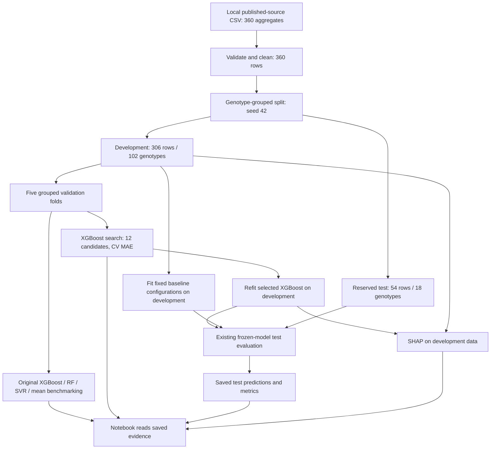
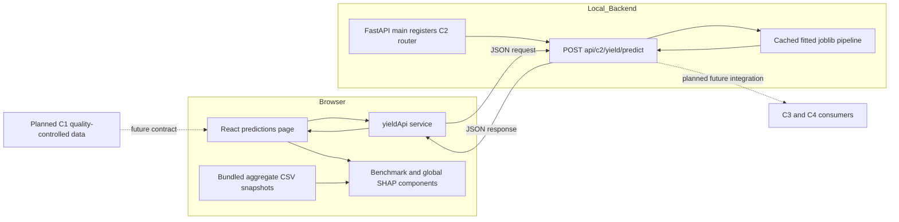

# C2 Yield Prediction: PP1 Implementation Evidence

Evidence review: **20 October 2026**. Project: **Explainable IoT Microclimate System for Smart Irrigation and Nai Miris (Capsicum chinense) Yield Forecasting**. Responsibility: **C2 — Predictive Intelligence**.

This is a trait-based research prototype with saved experiments, a prediction API and a React interface. It is not yet a validated Sri Lankan fresh-yield forecasting system. The original experiment tables below come from existing repository artifacts. The notebook now also includes a separately labeled, optional Model Training Demonstration with newly executed development-only results. No supervisor approval, field trial, deployment or live sensor evidence is asserted.

## 1. Research objectives and PP1 scope

The wider research aims to support irrigation and yield decisions through explainable predictions. This PP1 experiment evaluates whether five measured plant traits can estimate published genotype-year yield aggregates. It compares XGBoost with Random Forest, SVR and a training-target mean, investigates development-set SHAP explanations, and serves the existing tuned XGBoost through FastAPI and React.

The [executable research notebook](../../backend/notebooks/c2/yield_research_pp1.ipynb) contains exploration, preprocessing verification, grouped split checks, benchmark and tuning analysis, held-out diagnostics, existing SHAP figures and limitations, plus an optional cell-by-cell Model Training Demonstration. The [viva guide](PP1_Yield_Viva_Preparation.md) provides an explanation and demonstration sequence.

The root and backend READMEs describe an earlier shared scaffold and still say component routers are absent. For the C2 implementation, the [current API entry point](../../backend/app/main.py), [C2 page guide](../../frontend/src/pages/c2/README.md) and code linked here take precedence as evidence. They have not been edited in this task. No separate proposal PDF/DOCX was found in the local repository; proposal-specific approval or wording cannot be verified here.

## 2. Dataset source and preparation

| Evidence | Verified property |
| --- | --- |
| [Local source CSV](../../backend/data/c2/yield/raw/PeerJ_360_genotype_year_records.csv) | 360 rows, 21 columns, 120 genotypes, three records per genotype |
| Source fields | DOI `10.7717/peerj.15521`; India; CSIR-NEIST Jorhat Assam; *Capsicum chinense* |
| Study calendar years | 2017, 2018, 2019 |
| Observation unit | `genotype_year_trait_aggregate`; published replicates pooled, according to source metadata |
| Target | `fruit_yield_g_per_plant`, reported in g/plant |
| Yield weight basis | `not_explicitly_verified_fresh_or_dry` |
| [Cleaned CSV](../../backend/data/c2/yield/processed/peerj_yield_cleaned.csv) | 360 rows, 21 columns; no missing values, full-row duplicates or duplicate genotype-year keys |
| Target summary | Mean 416.437; SD 160.887; median 385.833; minimum 122.400; maximum 989.600 g/plant |

The cited publication is Baruah et al. (2023), *Estimation of genetic variation in yield, its contributing characters and capsaicin content of Capsicum chinense Jacq. (ghost pepper) germplasm from Northeast India*, [DOI record](https://doi.org/10.7717/peerj.15521). The [publisher PDF](https://peerj.com/articles/15521.pdf) identifies CC BY 4.0 for the article. The repository's CSV is a derived local representation. The supplementary workbook, extraction script and transformation audit trail are not present, so exact reconstruction from publisher records remains pending. Verify supplement-specific licensing and attribution before redistributing data; the repository software license is not sufficient evidence of dataset rights. Dry-weight wording about capsaicin must not be treated as verification of fruit-yield weight basis. No dataset or generated output was published by this task.

[Preprocessing code](../../backend/app/c2/yield_prediction/preprocessing.py) validates required columns, unique genotype/year keys, species and aggregate observation type; coerces predictors and target to numeric; removes missing-target records; rejects negative yield; sorts genotype/year; and preserves metadata. No rows are removed from the present source CSV. The notebook reproduces those transformations in memory and compares them with the cleaned CSV. There is no documented outlier removal or pre-split imputation.

## 3. Feature selection rationale

| Implemented predictor | Unit | Interpretation |
| --- | --- | --- |
| `plant_height_cm` | cm | Plant structural size |
| `main_branches` | count, fractional aggregate values allowed | Branching structure |
| `leaf_length_cm` | cm | Leaf dimension |
| `leaf_breadth_cm` | cm | Leaf dimension |
| `days_to_50pct_flowering` | days | Aggregate phenological timing |

The code fixes these five inputs; no ablation or systematic feature-selection experiment is recorded. Their biological interpretation provides a practical rationale, not proof that they are optimal. Flowering time must already be observable at prediction time, limiting early use. It does not make this a dynamic growth-stage-aware model.

Genotype ID is used for grouping, not prediction. Year, source and observation metadata are also excluded. Species and study site are constant. Capsaicin, fruit length/diameter, fruit count and days to maturity are not inputs. Some of these may only be available late or at harvest; fruit count is closely related to yield. Exclusion reduces the risk of using measurements unavailable at an intended earlier prediction cutoff. This is an availability/leakage rationale, not a claim that every excluded trait is inherently invalid. The outcome itself is always excluded.

The notebook's pooled Pearson plot is descriptive: flowering time correlates with yield at approximately 0.502 and height at 0.454; branch count is approximately 0.094. These correlations were not used for new model selection and do not establish causality.

## 4. Model training methodology

[Training implementation](../../backend/app/c2/yield_prediction/training.py) creates fresh scikit-learn pipelines for each fold and fits only the fold's training rows. Every pipeline includes median imputation; only SVR also includes StandardScaler. Both transformations are fitted inside the training fold. No full-dataset imputer/scaler is fitted before splitting.

| Original model | Fixed settings visible in code |
| --- | --- |
| XGBoost | 200 estimators; depth 3; learning rate 0.05; subsample 0.8; column subsample 0.8; squared-error objective |
| Random Forest | 200 trees; maximum depth 6; minimum leaf samples 2 |
| SVR | RBF kernel; C=10; epsilon=0.1; standardized inputs |
| Training Mean | DummyRegressor with `strategy="mean"` |

Random state is 42 where applicable. The training script refits the original planned XGBoost model on all 306 development rows and saves its fitted pipeline. Tuning separately produces the tuned pipeline used by the API. These scripts were inspected, not executed in this documentation task.

### Optional Model Training Demonstration in the notebook

The new section appears before the original dataset audit and can be run by itself in a fresh kernel. Its controls default to disabled unless explicitly enabled. Set `RUN_TRAINING_DEMO=True` in its controls cell, then execute the development-data preparation, pipeline inspection, XGBoost, Random Forest, SVR and summary cells in order. Markdown before and after each important step explains the code for a viva.

The section reads **only** `peerj_development.csv`, checks 306 rows/102 genotypes, and reuses the five saved `cv_fold` assignments through PredefinedSplit. It verifies these assignments against GroupKFold and checks genotype separation. For the short demonstration, fold 1 gives 243 training rows and 63 validation rows. It imports `create_models()` rather than duplicating the project's pipelines, clones fresh unfitted estimators, calls `.fit()` on training rows, calls `.predict()` on validation inputs, and computes MAE/RMSE/R² using the existing pure scoring helper. It displays training-fitted imputer medians and SVR scaler statistics.

Set `RUN_FULL_GROUPED_CV_DEMO=True` for all five validation folds (15 fresh model fits). Set `RUN_TUNING_DEMO=True` for a **two-candidate** RandomizedSearchCV example using the existing tuning script's parameter distributions, seed 42 and saved grouped folds. This deliberately small example is not the original 12-candidate experiment. The selected estimator is refitted on development records and retained only in memory. All demonstration tables are labeled **NEW DEVELOPMENT-ONLY DEMONSTRATION**; they are not new held-out scores or evidence of a better model. The recorded original tables in sections 6–9 remain separate.

The demonstration was actually executed, including both optional branches. A separate fresh-process validation installed a file-access guard that refused access to held-out/other datasets, saved models and experiment files; the development CSV was its only dataset access. No model was serialized and no original artifact was changed. See the [validation record](PP1_Yield_Validation.md) for newly executed results and reproducible controls. The notebook's other audit sections separately read held-out evidence for reporting; none of those variables feed the training cells.

## 5. Genotype-grouped validation methodology

[Split implementation](../../backend/app/c2/yield_prediction/split_data.py) reserves 15% of genotypes using GroupShuffleSplit with random state 42, then applies five-fold GroupKFold on development records.

| Partition | Rows | Genotypes | Use |
| --- | ---: | ---: | --- |
| [Development](../../backend/data/c2/yield/processed/peerj_development.csv) | 306 | 102 | Model fitting, grouped CV and tuning |
| [Final held-out test](../../backend/data/c2/yield/processed/peerj_test.csv) | 54 | 18 | Frozen-model evaluation; `cv_fold=-1` |

There is **zero genotype overlap**. All three years of a genotype stay in one partition and one development validation fold. The notebook reconstructs the saved holdout and fold assignments without saving datasets.

| Fold | Training rows | Validation rows | Training genotypes | Validation genotypes |
| --- | ---: | ---: | ---: | ---: |
| 1 | 243 | 63 | 81 | 21 |
| 2 | 243 | 63 | 81 | 21 |
| 3 | 246 | 60 | 82 | 20 |
| 4 | 246 | 60 | 82 | 20 |
| 5 | 246 | 60 | 82 | 20 |

Validation records change between folds and guide development decisions. The final test is separate from all five validation folds. The design measures generalization to unseen genotypes within this study; all study years occur across partitions, so it is not a future-year, new-farm or new-country evaluation. Code and artifacts support the intended separation, but they cannot independently prove every historical human decision was made before test inspection.

## 6. Baseline benchmarking

Source: [CV summary](../../backend/experiments/c2/yield/yield_cv_summary.csv), [20 fold-level metric rows](../../backend/experiments/c2/yield/yield_cv_fold_metrics.csv), and [1,224 out-of-fold predictions](../../backend/experiments/c2/yield/yield_cv_predictions.csv).

| Model | CV MAE mean ± SD (g/plant) | CV RMSE mean ± SD (g/plant) | CV R² mean ± SD |
| --- | ---: | ---: | ---: |
| Random Forest | 94.932 ± 9.923 | 120.792 ± 12.346 | 0.373 ± 0.202 |
| Original XGBoost | 97.468 ± 9.236 | 125.007 ± 11.639 | 0.329 ± 0.212 |
| SVR | 106.261 ± 5.261 | 136.240 ± 10.666 | 0.233 ± 0.072 |
| Training Mean | 127.434 ± 9.746 | 158.148 ± 14.206 | -0.028 ± 0.029 |

These are unweighted fold means and sample SDs, not pooled scores or confidence intervals. Random Forest has the lowest original CV MAE. Random Forest and SVR are **learned baselines**. Training Mean is the simple reference, predicting each training fold's target mean. The notebook verifies those constant predictions as well as recalculating all fold scores. Learned models beat the simple reference here; this does not establish field accuracy.

## 7. Hyperparameter tuning

[Tuning code](../../backend/app/c2/yield_prediction/tune_xgboost.py), [12-candidate search results](../../backend/experiments/c2/yield/xgboost_tuning_results.csv) and [selected metadata](../../backend/models/c2/yield/xgboost_tuning_metadata.json) show RandomizedSearchCV using negative MAE, seed 42 and PredefinedSplit reusing the five grouped folds. The search samples estimator count, depth, learning rate, minimum child weight, row/column subsampling and L2 regularization. It refits the selected pipeline on development data.

Selected values: `n_estimators=100`, `max_depth=2`, `learning_rate=0.1`, `min_child_weight=1`, `subsample=1.0`, `colsample_bytree=1.0`, `reg_lambda=5`.

Original XGBoost CV MAE is **97.468 g/plant**; tuning-selected CV MAE is **92.901 g/plant**. The notebook checks the winning CSV row against JSON metadata and the five search-fold scores. Search output contains MAE only: tuned CV RMSE/R² are unavailable. Using these same validation folds for selection and reporting can give optimistic estimates; this was not nested CV. `test_evaluated=false` in model metadata is a training-stage statement, not a current evaluation registry: the separate final-test CSVs show later evaluation.

## 8. Final held-out evaluation

Source: [final test metrics](../../backend/experiments/c2/yield/yield_final_test_metrics.csv), [216 prediction rows](../../backend/experiments/c2/yield/yield_final_test_predictions.csv), and [evaluation code](../../backend/app/c2/yield_prediction/evaluation.py).

| Model | MAE (g/plant) | RMSE (g/plant) | R² |
| --- | ---: | ---: | ---: |
| Tuned XGBoost | 120.274 | 167.548 | 0.096 |
| Random Forest | 114.499 | 158.717 | 0.189 |
| SVR | 109.857 | 155.793 | 0.218 |
| Training Mean | 137.070 | 176.594 | -0.004 |

The evaluation script loads tuned XGBoost; it fits the fixed baseline/reference configurations on development data, then evaluates all four on the same 54 test rows. It was **not rerun** here. The notebook recalculates metrics from saved predictions and checks actual targets/genotype order against the held-out CSV. The prediction output omits study year, so genotype ID alone is not a unique join key; row-order consistency is checked rather than assuming unique genotypes.

**SVR has the lowest error on this preliminary held-out test. XGBoost is the planned primary/API model, not the best-performing test model.** This task neither changes the serving model nor conducts new selection using the test set. The reason for SVR's ranking is not established. Smoothness, regularization and sampling variation are plausible hypotheses requiring development-only follow-up and an untouched future test.

MAE is average absolute error; RMSE gives greater weight to large misses. Both retain g/plant units. R² is unitless and uses the test-mean predictor as its squared-error reference. Training Mean actually uses the development mean, explaining why its test R² need not be zero. R²=0.096 is limited explanatory performance, not 9.6% prediction accuracy. Only 18 genotype groups support the holdout; no significance or uncertainty intervals are claimed.

Existing graphs: [model comparison](../../backend/experiments/c2/yield/final_model_comparison.png) and [XGBoost agreement plot](../../backend/experiments/c2/yield/xgboost_actual_vs_predicted.png). The notebook also renders all four agreement plots and residual histograms/scatters from the saved CSV. Residual is actual minus predicted; positive residual means underprediction. Diagnostics are descriptive, not calibrated prediction intervals.

## 9. Explainable AI findings

[SHAP code](../../backend/app/c2/yield_prediction/explainability.py) applies the development-fitted median imputer and TreeExplainer to the tuned XGBoost on 306 development rows. [Saved importance CSV](../../backend/experiments/c2/yield/shap_feature_importance.csv):

| Rank | Feature | Mean absolute SHAP (g/plant) |
| --- | --- | ---: |
| 1 | Plant height | 53.157 |
| 2 | Days to 50% flowering | 36.620 |
| 3 | Leaf breadth | 22.375 |
| 4 | Main branches | 16.988 |
| 5 | Leaf length | 14.523 |

Reuse the [global importance plot](../../backend/experiments/c2/yield/shap_feature_importance.png) and [beeswarm](../../backend/experiments/c2/yield/shap_summary_beeswarm.png). Magnitude ranks average model contribution; it does not state direction. The beeswarm shows signed contributions and feature-value coloring. Correlated traits can share attribution. These development-set explanations are not independent validation.

The frontend displays static global importance. It does not compute a submitted plant's individual SHAP explanation. A local explanation would require contributions and a baseline for that specific prediction. SHAP explains the fitted model and **does not prove causality** or justify changing a plant trait to cause a yield increase.

## 10. FastAPI endpoint implementation

[Router](../../backend/app/c2/yield_prediction/routes.py) defines `POST /api/c2/yield/predict`, registered by [main.py](../../backend/app/main.py). Pydantic requires all five numeric fields: nonnegative height, branches and leaf dimensions; flowering days strictly positive. There are no empirical upper-range checks in the schema. Fractional aggregate branch values are accepted. Stronger finite/range validation and structured missing-model errors remain technical improvements; do not imply the backend enforces them already.

The route loads the trusted local `backend/models/c2/yield/xgboost_tuned_development.joblib` through a one-entry `lru_cache`, orders a one-row DataFrame using `FEATURES`, predicts with the fitted pipeline and rounds to two decimals. It returns:

```json
{
  "predicted_yield_g_per_plant": 489.18,
  "model": "Tuned XGBoost",
  "prediction_type": "experimental_trait_based_yield_estimate",
  "yield_weight_basis": "not_verified_fresh_or_dry",
  "unit": "g/plant",
  "warning": "Research prototype trained on published genotype-year aggregates. Not validated for Sri Lankan field-level fresh yield."
}
```

The numeric example corresponds to test inputs 65, 5, 10, 5 and 80 in feature order, as recorded in [earlier verification](../../frontend/tests/c2/VERIFICATION.md). It is a demonstration request, not a field observation or an evaluation metric. `/health` reports shared service status; `/docs` provides interactive schemas. Browser CORS allows localhost and 127.0.0.1 on port 5173. This is local development configuration, not deployment evidence.

## 11. React frontend integration

[YieldPrediction.jsx](../../frontend/src/pages/c2/YieldPrediction.jsx) is mounted at `/predictions`. [Transport service](../../frontend/src/services/c2/yieldApi.js) converts the five inputs to numbers and posts JSON to the existing API, with finite-value checks, schema-bound validation, 30-second timeout, cancellation and response validation. Editing clears stale results; reset cancels the active request. Loading, errors and retry are handled in page state.

The form/result, benchmark and explanation components are [YieldPredictionForm](../../frontend/src/components/c2/YieldPredictionForm.jsx), [YieldPredictionResult](../../frontend/src/components/c2/YieldPredictionResult.jsx), [YieldModelComparison](../../frontend/src/components/c2/YieldModelComparison.jsx) and [YieldExplainability](../../frontend/src/components/c2/YieldExplainability.jsx). [yieldResearch.js](../../frontend/src/services/c2/yieldResearch.js) loads aggregate CSV snapshots; the benchmark selector changes the displayed metric, not the serving model. [Asset provenance](../../frontend/src/assets/c2/README.md) describes the bundled evidence. No observation-level dataset or joblib model is bundled by this feature.

The service defaults to `http://127.0.0.1:8000`; `VITE_API_BASE_URL` can override it. Vite's root is `frontend/src/`, so its local env-file location differs from the repository root. See the [C2 run guide](../../frontend/src/pages/c2/README.md). No live sensor stream, weather input or C1/C3/C4 data transfer is implemented by this yield flow.

## 12. System architecture and data flow

### Yield prediction pipeline


### Model training and evaluation workflow



The notebook audits original outputs and can optionally fit fresh development-only models in its separately labeled demonstration. It does not invoke the artifact-writing training/evaluation entry points or evaluate new fitted models on the held-out test. There is no feedback arrow from the test results into tuning.

### C2 FastAPI and React integration



Dashed arrows are planned interfaces only. They are not evidence of completed inter-component connections.

## 13. Testing and verification evidence

The [validation record](PP1_Yield_Validation.md) distinguishes fresh checks from prior test records and lists execution limits. The [local notebook runner](../../backend/notebooks/c2/verify_yield_research_pp1.py) executes all Python cells sequentially using the existing environment, captures tables/plots in the notebook, and writes only that notebook. It is not a Jupyter kernel or full nbformat-schema validator.

Notebook assertions check dataset shape/missing values/key uniqueness; in-memory preprocessing equivalence; complete split coverage and exact saved split/fold reconstruction; group separation; CV predictions, every fold metric and summary; tuning CSV/metadata agreement; all final-test scores and actual-target order; mean-reference predictions; SHAP feature coverage; image readability; and unchanged hashes of original evidence. Optional joblib files are reported for availability, not loaded. Thus CSV-based analysis remains executable without them.

The existing [frontend verification record](../../frontend/tests/c2/VERIFICATION.md) reports prior Chromium live-API, responsive layout, accessibility and screenshot inspection. Those are attributed historical records, not a claim that the browser audit was repeated in this task. The eight [Node service tests](../../frontend/tests/c2/yieldApi.test.mjs) were rerun here; they isolate transport/validation behavior and do not by themselves prove live inference or browser accessibility.

### Manual screenshot capture for the PP1 evidence pack

No screenshot files are fabricated or claimed as captured by this task. Capture locally after running the existing backend and frontend:

1. From `backend/`, activate `.venv` and run `python -m uvicorn app.main:app --reload --port 8000`. From `frontend/`, run `npm run dev` using existing installed dependencies.
2. Open `http://localhost:5173/predictions`; capture the page title, five labeled inputs and research-prototype notice. Avoid personal information.
3. Enter 65, 5, 10, 5 and 80 in displayed feature order; submit. Capture the result together with submitted values, model name, units and limitations. Label these as example inputs, not field readings.
4. Capture the expanded held-out metric table and global SHAP section, including source/limitation text. Capture a narrow viewport separately if needed.
5. Open `http://localhost:8000/docs`, execute the same request and capture the endpoint, body and actual response. Save an invalid-request example separately if useful.
6. In VS Code, capture executed notebook split/fold assertions, CV table, final-test table, residual figure and SHAP plot. Do not crop away headings that distinguish CV from testing.
7. Save under a local evidence folder such as `docs/c2/screenshots/` with descriptive filenames and a capture-date note. That folder is not supplied here; review permissions before sharing or adding source-derived screenshots to version control.

## 14. Known scientific and technical limitations

- Aggregate genotype-year records cannot establish individual-plant performance or reconstruct replicate variability. Repeated years reduce independence; 360 records are not 360 independent experimental subjects.
- The source is one Indian study context; local Nai Miris cultivar, soil, management and climate differences remain untested. There is no Sri Lankan field-level validation.
- Fruit-yield fresh/dry basis is unverified. The target has no implemented future harvest-date/horizon definition. It is not a seven-day fresh-yield forecast.
- No weather, live IoT measurements or dynamic growth-stage features enter this yield model. Days to flowering is a summary trait with an availability constraint.
- Tuning-selected CV can be optimistic. Test performance is limited and based on 18 groups. There are no validated uncertainty intervals or significance claims.
- Global SHAP explains the fitted model, not causal crop responses or each submitted input. The API returns no local attribution.
- Publisher-to-CSV reconstruction is incomplete locally. Source-specific terms must be checked before redistribution. Notebook outputs can expose source-derived values and remain local pending review.
- Current requirements do not list all runtime dependencies used by the code (for example XGBoost/joblib), and the existing environment lacks Jupyter packages. No dependency/lockfile repair was authorized or performed here. Preserve the working environment for the demo and record versions.
- Joblib deserialization must be restricted to trusted artifacts. The fitted model files are local and Git-ignored. Missing models will prevent API prediction even though CSV analysis still works.
- Metadata has no comprehensive versioned release registry; static frontend CSVs require explicit refresh when experiments change. API input checks do not enforce source-data ranges or a field-valid applicability domain.
- Backend error formatting, finite/range checks, external validation, human screen-reader and non-Chromium checks remain improvement items. No production deployment or sensor reliability claim follows from local tests.

## 15. Completed work versus pending work

| Status | Work |
| --- | --- |
| Existing implementation verified by inspection/artifacts | Preprocessing, saved grouped splits, CV benchmarks, XGBoost tuning, saved final-test evaluation and development SHAP |
| Existing implementation | Tuned XGBoost API; manually entered trait form; result, benchmark and global SHAP UI |
| Created and executed in this task | Research notebook with stored local outputs; execution harness; dataset/split/metric audits; optional in-memory model fitting, grouped CV and small tuning demonstration |
| Created in this task | This evidence guide, three Mermaid diagrams, viva guide and validation record |
| Pending manual evidence | Fresh screenshot pack and interactive VS Code Jupyter Run All after kernel setup |
| Pending scientific work | Source supplement/extraction audit, yield-basis verification, local longitudinal dataset, target/horizon definition and external validation |
| Planned integration | C1 contract and live data, weather-informed modeling, C3/C4 consumers and any field deployment |

## 16. Next development milestones

1. Before PP1: retain this notebook and saved CSV evidence, rehearse the API/UI demo, prepare the VS Code kernel and capture dated screenshots. For cell-by-cell fitting, use only the notebook's opt-in development-only demonstration; do not rerun the artifact-writing experiment scripts.
2. Resolve provenance: retain the original supplement and exact derivation procedure, confirm fruit-yield basis and any redistribution conditions.
3. Define the next target: distinguish cumulative yield from harvest-interval fresh mass, specify prediction time and horizon, and ensure all inputs exist at that time.
4. Collect consented Sri Lankan records across plots/farms/seasons with plant/genotype IDs, timestamps, growth stage, fresh harvest weights, management and calibrated C1 measurements.
5. Agree data contracts and validate them independently. Evaluate future candidates with development-only or nested grouped/temporal selection, then a new untouched external test and uncertainty assessment.
6. Add individual SHAP only with a reviewed explanation contract; improve model/environment versioning and applicability checks. Integrate C3/C4 only after contracts and evidence support it.
